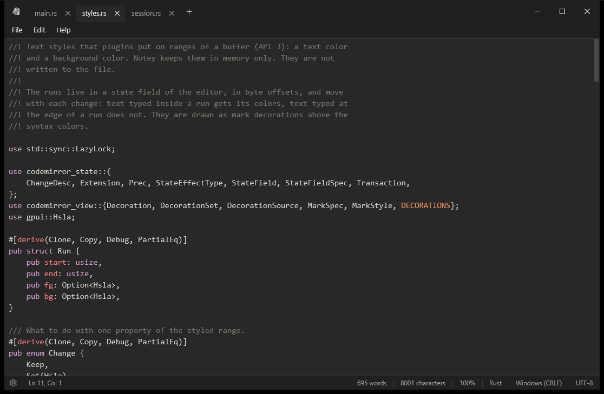

A native Rust notepad for Windows, styled after Windows 11 Notepad: dark
mode, tabs, spellcheck, syntax highlighting for 45 file types, and plugins,
including live math in any tab.

## Download

Get `NoteySetup.exe` from the
[latest release](https://github.com/deepfold9118/notey/releases/latest).
It installs for your user account only, so it needs no administrator
rights, and Notey keeps itself up to date after that.
The [changelog](https://github.com/deepfold9118/notey/blob/main/CHANGELOG.md)
lists what changed in each version.

## Documentation

- [User guide](guide.md): tabs, search, settings, the editor and plugins.
- [Math](https://github.com/deepfold9118/notey/blob/main/plugins/features/feature-math/README.md):
  the reference for the Math plugin, which writes the results of
  calculations into your text as you type.
- [Plugin API](plugin-api.md): write your own Rhai scripts and plugins.

## For developers

Notey is open source under the Apache License 2.0; the code is on
[GitHub](https://github.com/deepfold9118/notey). It is built with
[GPUI](https://crates.io/crates/gpui), the UI framework of the Zed editor,
and [codemirror-rs](https://github.com/deepfold9118/codemirror-rs), a Rust
port of CodeMirror 6.

- [Rebuilding Notey on GPUI](gpui-rebuild.md)
- [CodeMirror-style editing core design](codemirror-rust-design.md)
